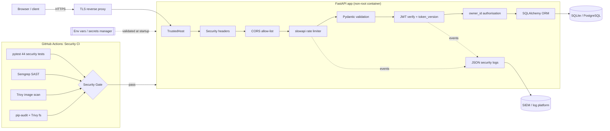

<div align="center">

# 🔐 Secure Task API

**A production-style task manager API built secure-by-design, with security controls at every stage of the SDLC.**

[](https://github.com/Gav-debug8888/secure-task-api/actions/workflows/security-ci.yml)


**🌐 Live demo:** [secure-task-api-1711.onrender.com/health](https://secure-task-api-1711.onrender.com/health)

</div>

---

Most demo APIs show *what* an app does. This one shows **how it's protected**. Every control below is real, working code, backed by an automated test and traced to a threat from my [threat model](https://github.com/Gav-debug8888/Fintech-Threat-Model).

## Security features

| # | Feature | Implementation | Why it matters |
|---|---------|----------------|----------------|
| 1 | **JWT authentication** | 15-min access + 7-day refresh tokens in `HttpOnly; Secure; SameSite=Strict` cookies. Refresh **rotation with reuse detection**. Instant revocation via `token_version`. | Stolen tokens expire quickly. XSS can't read them. A replayed refresh token kills every session for that user. |
| 2 | **Password hashing** | bcrypt, work factor **12**. 72-byte limit enforced. Constant-time login for unknown users. | A leaked DB doesn't reveal passwords. Response timing doesn't reveal which usernames exist. |
| 3 | **Input validation** | Pydantic v2 strict schemas: length limits, regex, enums, `extra="forbid"` | Blocks injection payloads, oversized input and mass assignment (`"owner_id": 1`). |
| 4 | **SQL injection prevention** | SQLAlchemy ORM only. Zero raw SQL. | Removes the #3 OWASP risk class. Enforced by Semgrep in CI. |
| 5 | **Rate limiting** | slowapi: **5/min** on auth, **100/min** on tasks, JSON 429 + `Retry-After` | Stops brute force and credential stuffing without locking real users out. |
| 6 | **Security headers** | CSP `default-src 'none'`, HSTS (2y, preload), `X-Frame-Options: DENY`, nosniff, `X-XSS-Protection: 0`, Referrer/Permissions policies. `Server` header removed. | Defence in depth against clickjacking, MIME sniffing and XSS. |
| 7 | **CORS** | Explicit origin allow-list. `*` and non-HTTPS origins **rejected at startup**. | Credentialed cross-origin requests only from your frontend. |
| 8 | **Secrets management** | `pydantic-settings`. App **refuses to start** if `JWT_SECRET_KEY` is missing, < 32 chars or a placeholder. | No "we shipped with `changeme`" incidents. |
| 9 | **Security logging** | JSON events: `login_failed`, `refresh_token_reuse_detected`, `task_access_denied`, `rate_limit_exceeded` ... Never logs secrets. | SIEM-ready detection and an incident-response trail. |
| 10 | **Health check** | `GET /health` → `{"status": "ok"}`, nothing else | Liveness without giving attackers reconnaissance. |
| ➕ | **Object-level authorisation** | Every query scoped to `owner_id`. Foreign IDs return 404. | Prevents IDOR/BOLA, the #1 OWASP API risk. |
| ➕ | **Hardened container** | Multi-stage, non-root UID 10001, read-only rootfs, `cap_drop: ALL`, `no-new-privileges` | Limits the impact if the app is ever compromised. |
| ➕ | **Supply-chain-safe CI** | Actions pinned to commit SHAs, tools version-pinned, Dependabot with cooldown | Protects against tag-poisoning attacks such as the March 2026 trivy-action compromise. |

## Architecture



Deep dive: [`docs/security-architecture.md`](docs/security-architecture.md)

## Quick start (Docker)

```bash
git clone https://github.com/Gav-debug8888/secure-task-api.git
cd secure-task-api

cp .env.example .env
# Generate a real secret and paste it into .env as JWT_SECRET_KEY
python -c "import secrets; print(secrets.token_urlsafe(48))"
# For plain-http local testing ONLY, also set: COOKIE_SECURE=false

docker compose up --build
curl http://127.0.0.1:8000/health      # {"status":"ok"}
```

### Without Docker
```bash
python -m venv .venv && source .venv/bin/activate
pip install -r requirements-dev.txt
export JWT_SECRET_KEY="$(python -c 'import secrets; print(secrets.token_urlsafe(48))')"
export ENVIRONMENT=development COOKIE_SECURE=false
uvicorn app.main:app --reload       # docs at http://127.0.0.1:8000/docs (dev only)
```

### Try it
```bash
curl -X POST localhost:8000/api/auth/register -H 'Content-Type: application/json' \
  -d '{"email":"gav@example.com","username":"gav","password":"Correct-Horse-42!"}'
curl -c jar -X POST localhost:8000/api/auth/login -H 'Content-Type: application/json' \
  -d '{"username":"gav","password":"Correct-Horse-42!"}'
curl -b jar -X POST localhost:8000/api/tasks -H 'Content-Type: application/json' \
  -d '{"title":"Ship secure code","priority":"high"}'
curl -b jar localhost:8000/api/tasks
```

## Environment variables

| Variable | Required | Default | Description |
|----------|----------|---------|-------------|
| `JWT_SECRET_KEY` | ✅ | none | ≥ 32 chars, not a placeholder. **The app won't start without it.** |
| `ENVIRONMENT` | | `production` | `development` \| `test` \| `production` (production disables `/docs` and enables TrustedHost) |
| `JWT_ALGORITHM` | | `HS256` | `HS256` / `HS384` / `HS512` |
| `ACCESS_TOKEN_EXPIRE_MINUTES` | | `15` | 1–60 |
| `REFRESH_TOKEN_EXPIRE_DAYS` | | `7` | 1–30 |
| `DATABASE_URL` | | `sqlite:///./tasks.db` | Any SQLAlchemy URL |
| `CORS_ORIGINS` | | `http://localhost:3000` | Comma-separated. HTTPS (or localhost) only. `*` is rejected. |
| `ALLOWED_HOSTS` | | `localhost,127.0.0.1` | Host header allow-list (production) |
| `COOKIE_SECURE` | | `true` | Set `false` only for plain-http local development |
| `COOKIE_SAMESITE` | | `strict` | `strict` \| `lax` |
| `RATE_LIMIT_ENABLED` | | `true` | Turn rate limiting on or off |
| `AUTH_RATE_LIMIT` / `TASK_RATE_LIMIT` | | `5/minute` / `100/minute` | slowapi syntax |
| `RATE_LIMIT_STORAGE_URI` | | `memory://` | Use `redis://...` for multiple replicas |

## Live deployment

The API is deployed on Render's free tier at **https://secure-task-api-1711.onrender.com**. It runs from the hardened `python:3.12-alpine` image with `ENVIRONMENT=production`. Interactive docs (`/docs`) are switched off in production on purpose, so use the endpoints below.

These controls were checked against the live deployment:

| Check | Result |
|-------|--------|
| `GET /health` | `200 {"status":"ok"}` |
| Security headers | CSP `default-src 'none'`, HSTS (2 years, preload), `nosniff`, `X-Frame-Options: DENY` |
| Server banner | No uvicorn version leaked |
| Spoofed `Host: evil.com` | `403` (TrustedHost allow-list) |
| `/docs` in production | `404` (disabled) |
| Register a user | `201 Created` |
| 6 bad logins within a minute | `401` ×5, then `429 Too Many Requests` |

Try it yourself:

```bash
# Health check
curl https://secure-task-api-1711.onrender.com/health

# Inspect the security headers
curl -I https://secure-task-api-1711.onrender.com/health

# Host-header allow-list (expect 403)
curl -i -H "Host: evil.com" https://secure-task-api-1711.onrender.com/health

# Brute-force protection (the 6th attempt returns 429)
for i in 1 2 3 4 5 6; do
  curl -s -o /dev/null -w "%{http_code}\n" -X POST \
    https://secure-task-api-1711.onrender.com/api/auth/login \
    -H "Content-Type: application/json" \
    -d '{"username":"nobody","password":"wrong-password"}'
done
```

> **Free-tier notes:** the service sleeps after about 15 minutes idle, so the first request can take around 50 seconds. The SQLite database has no persistent disk, so its data resets whenever the service restarts.

## API endpoints

| Method | Path | Auth | Limit | Description |
|--------|------|------|-------|-------------|
| GET | `/health` | none | none | Liveness |
| POST | `/api/auth/register` | none | 5/min | Create an account |
| POST | `/api/auth/login` | none | 5/min | Log in (sets cookies) |
| POST | `/api/auth/refresh` | refresh cookie | 5/min | Rotate tokens |
| POST | `/api/auth/logout` | ✅ | none | Revoke all tokens |
| GET | `/api/auth/me` | ✅ | none | Current user |
| GET | `/api/tasks` | ✅ | 100/min | List own tasks (`status`, `priority`, `limit` ≤ 100, `offset`) |
| POST | `/api/tasks` | ✅ | 100/min | Create a task |
| GET / PATCH / DELETE | `/api/tasks/{id}` | ✅ | 100/min | Read, update or delete an own task |

Full reference: [`docs/api-reference.md`](docs/api-reference.md)

## Security testing

```bash
pip install -r requirements-dev.txt

# 1. Security unit tests (44): IDOR, JWT forgery, alg=none, refresh reuse,
#    rate limiting, mass assignment, headers, CORS, fail-closed config...
pytest -v

# 2. SAST: same command and threshold as CI
semgrep scan --config=auto --severity=ERROR --error

# 3. Dependency CVEs
pip-audit -r requirements.txt --strict

# 4. Container scan
docker build -t secure-task-api:local .
trivy image --exit-code 1 --severity HIGH,CRITICAL --ignore-unfixed secure-task-api:local
```

On every push and PR, [`.github/workflows/security-ci.yml`](.github/workflows/security-ci.yml) runs all four and blocks the merge through a single required **Security Gate** check. It follows the same pattern as Project 3.

## Security across the SDLC

| Phase | What I did | Artefacts |
|-------|------------|-----------|
| **1. Design** | Threat-modelled first using STRIDE, MITRE ATT&CK and the Kill Chain. Each relevant threat is mapped to a control *before* writing code. Chose cookies over `localStorage`, and 404-over-403 for authorisation failures. | [Fintech-Threat-Model](https://github.com/Gav-debug8888/Fintech-Threat-Model), [`docs/threat-model-link.md`](docs/threat-model-link.md), [`docs/security-architecture.md`](docs/security-architecture.md) |
| **2. Development** | Secure defaults in the framework layer: ORM only, strict Pydantic schemas, fail-closed config, central auth dependency, structured security logging. No secrets in code (`.env.example` placeholders only). | `app/`, `.env.example` |
| **3. Testing** | 44 automated tests that **attack** the app (alg=none, forged keys, IDOR, mass assignment, SQLi payloads, brute force, refresh replay). SAST (Semgrep), SCA (pip-audit) and container scanning (Trivy) in CI. | `tests/`, `security-ci.yml` |
| **4. Deployment** | Multi-stage non-root image, read-only rootfs, dropped capabilities, localhost-bound port behind a TLS proxy, docs disabled in production, Host allow-list. SHA-pinned CI actions and Dependabot with cooldown. | `Dockerfile`, `docker-compose.yml`, `.github/dependabot.yml` |
| **5. Operate & respond** | JSON security event catalogue with suggested SIEM alerts. Vulnerability disclosure policy with response SLAs. Secret-rotation runbook (revokes all sessions). | [`SECURITY.md`](SECURITY.md), [`docs/security-architecture.md`](docs/security-architecture.md#security-event-catalogue) |

## Project structure
```
secure-task-api/
├── app/
│   ├── main.py               # App factory, middleware, error handlers, /health
│   ├── config.py             # Fail-closed settings (pydantic-settings)
│   ├── auth.py               # bcrypt, JWT issue/verify, current-user dependency
│   ├── models.py             # SQLAlchemy models
│   ├── schemas.py            # Strict Pydantic schemas
│   ├── database.py
│   ├── logging_config.py     # JSON security event logging
│   ├── routes/{auth,tasks}.py
│   └── middleware/{rate_limiter,security_headers}.py
├── tests/                    # 44 security-focused tests
├── .github/workflows/security-ci.yml
├── Dockerfile · docker-compose.yml · .env.example
├── SECURITY.md
└── docs/ (api-reference · security-architecture · threat-model-link)
```

## Portfolio series

| # | Project | Focus |
|---|---------|-------|
| 1 | [Fintech-Threat-Model](https://github.com/Gav-debug8888/Fintech-Threat-Model) | STRIDE, MITRE ATT&CK, Kill Chain, Mermaid diagrams |
| 2 | [devsecops-vulnerable-app](https://github.com/Gav-debug8888/devsecops-vulnerable-app) | Find and fix vulnerabilities with an AI-assisted PR |
| 3 | [devsecops-cicd-security](https://github.com/Gav-debug8888/devsecops-cicd-security) | Trivy + Semgrep pipeline that blocks insecure PRs |
| 4 | **secure-task-api** (this repo) | A real app secured across the SDLC |

## Licence
MIT
