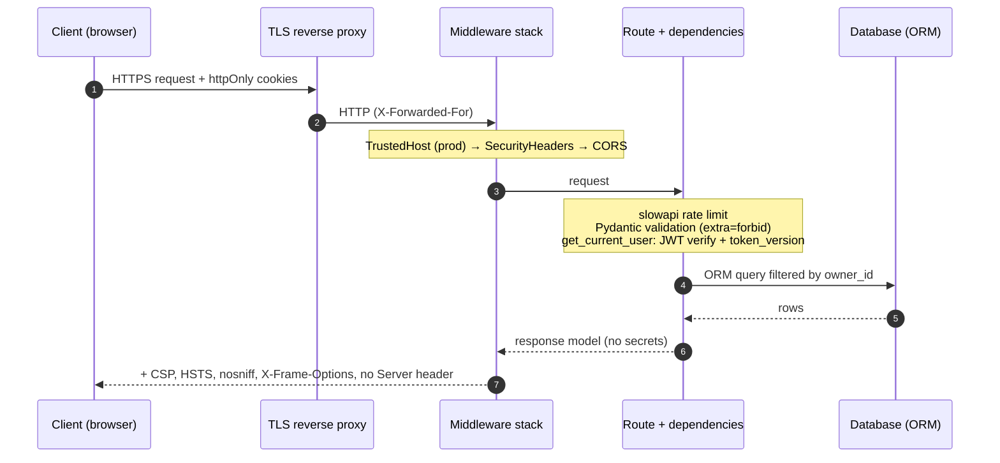

# Security Architecture

## Request lifecycle

## Defence-in-depth layers

| Layer | Control | Implementation | Threat addressed |
|-------|---------|----------------|------------------|
| Transport | HTTPS + HSTS (2 years, preload) | TLS at proxy, `Strict-Transport-Security` header | Downgrade attacks, session hijacking |
| Edge | Host header allow-list | `TrustedHostMiddleware` (production) | Host header injection, cache poisoning |
| Edge | CORS explicit origins | `CORSMiddleware`. `*` rejected at startup. | Cross-origin data theft |
| Edge | Rate limiting | slowapi: 5/min auth, 100/min tasks, per IP | Brute force, credential stuffing, scraping |
| Browser | Security headers | Pure-ASGI `SecurityHeadersMiddleware` | Clickjacking, MIME sniffing, XSS impact |
| Input | Schema validation | Pydantic v2, strict types, length and regex limits, `extra="forbid"` | Injection, mass assignment, oversized payloads |
| AuthN | Password storage | bcrypt, cost 12, 72-byte limit enforced | Offline cracking after a DB leak |
| AuthN | Session tokens | JWT HS256, 15-min access / 7-day refresh, httpOnly + Secure + SameSite=Strict cookies | Token theft by XSS, CSRF |
| AuthN | Token revocation | `token_version` claim (logout), refresh rotation + reuse detection (`refresh_jti`) | Stolen refresh tokens, persistent sessions |
| AuthZ | Object-level checks | Every query filters `owner_id`. 404 for foreign objects. | IDOR / BOLA (OWASP API1) |
| Data | Injection-safe access | SQLAlchemy ORM only, no `text()` or raw SQL | SQL injection |
| Errors | No information leakage | Generic 500 handler, 422 without echoed input, docs off in prod | Reconnaissance |
| Config | Fail-closed secrets | `pydantic-settings` validates `JWT_SECRET_KEY` (≥ 32 chars, not a placeholder) at import | Running with default or weak secrets |
| Logging | Structured security events | JSON logs: `login_success`, `login_failed`, `token_refreshed`, `refresh_token_reuse_detected`, `rate_limit_exceeded`, `task_access_denied` ... | Detection and incident response |
| Runtime | Container hardening | Multi-stage build, UID 10001, read-only rootfs, `cap_drop: ALL`, `no-new-privileges`, resource limits | Container escape, lateral movement |
| Supply chain | CI gate | Semgrep + Trivy + pip-audit, actions pinned to SHAs, Dependabot with 7-day cooldown | Vulnerable or compromised dependencies |

## Key design decisions

### Why cookies instead of `localStorage` for JWTs?
A token in `localStorage` can be read by any script on the page. One XSS bug would leak every session. `HttpOnly` cookies can't be read by JavaScript. `SameSite=Strict` stops browsers from attaching them to cross-site requests, which is the main CSRF mitigation. The refresh cookie is scoped to `/api/auth/refresh`, so it is only sent to that one endpoint.

> **CSRF note:** `SameSite=Strict` plus a strict CORS allow-list (no credentialed cross-origin requests from unknown origins) and JSON-only bodies protect against classic CSRF. If you relax to `SameSite=Lax` or serve the frontend from another site, add a double-submit CSRF token.

### Why `token_version` and `refresh_jti`?
JWTs are stateless, so they cannot normally be revoked before they expire. Two small database fields fix this:
- `token_version` is embedded in every token. Logout increments it, so every older token fails the check in `user_from_claims`.
- `refresh_jti` stores the ID of the *only* valid refresh token. Each refresh rotates it. If an old refresh token is presented, it must have been copied, so the server revokes the whole token family (the [OAuth 2.0 Security BCP](https://datatracker.ietf.org/doc/html/rfc9700) pattern).

### Why return 404 instead of 403 for other users' tasks?
A 403 confirms the object exists. Returning 404 for both missing and foreign objects stops an attacker from enumerating IDs. Access attempts are still logged on the server as `task_access_denied`.

### Why `X-XSS-Protection: 0`?
The legacy browser XSS auditor has been removed from modern browsers, and in older ones it *introduced* vulnerabilities. OWASP now recommends turning it off explicitly and relying on CSP. The header is still sent, so scanners can see the decision was deliberate.

### Constant-time login
When the username doesn't exist, the server still runs a bcrypt comparison against a dummy hash. Without this, an unknown user would get a response about 250 ms faster, which reveals which usernames are registered.

## Security event catalogue

| Event | Level | Fields | Suggested alert |
|-------|-------|--------|-----------------|
| `login_success` | INFO | user_id, ip | Impossible-travel analytics |
| `login_failed` | WARNING | username, ip | > 20 per IP in 5 min |
| `rate_limit_exceeded` | INFO | ip, path, limit | Spike detection |
| `token_refreshed` | INFO | user_id, ip | none |
| `refresh_token_reuse_detected` | ERROR | user_id, ip | **Page on-call**: likely token theft |
| `token_invalid` / `token_type_mismatch` | INFO | token_type | Sustained volume = forging attempts |
| `task_access_denied` | WARNING | user_id, task_id | > 5 per user in 1 min = IDOR probing |
| `register_conflict` | WARNING | ip | Enumeration attempts |
| `logout`, `user_registered`, `app_started` | INFO | various | Audit trail |

Passwords, tokens and request bodies are **never** logged.

## Known limitations and roadmap
- **No MFA yet.** TOTP/WebAuthn is the top item on the roadmap (Project 1, T01/T04).
- **Rate limits are per IP.** Add per-account limits to resist distributed credential stuffing.
- **In-memory rate-limit storage.** Use Redis (`RATE_LIMIT_STORAGE_URI`) when running more than one replica.
- **HS256 shared secret.** For multi-service architectures, move to RS256/EdDSA with keys in a KMS (Project 1, T03).
- **SQLite default.** Use PostgreSQL with a least-privilege DB user in production.
